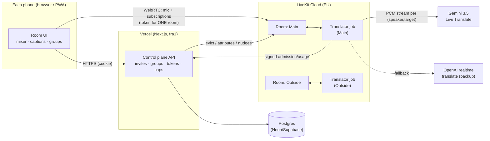

# Architecture

## Two layers: gathering vs. conversation group

- A **gathering** is the invite-only container for up to 8 humans (Postgres).
- Each **conversation group** (Main, Outside, …) is its own LiveKit room with
  a random name. A participant holds a token for exactly **one** room: the
  room of their `active_group_id`. Moving between groups is a server
  transaction that increments `active_epoch`, drops private membership of the
  group being left, and **evicts** the participant from the old room through
  the LiveKit server API before the new token is returned.
- One translator job runs per group room (LiveKit agent dispatch embedded in
  every token), so translation streams, captions and tracks never cross rooms.

## Trust boundaries

| Data | Who can write it | Who trusts it |
|---|---|---|
| Room choice | server only (from Postgres) | everyone |
| Participant attributes (languages, epoch, group) | server only (token + `UpdateParticipant`; `canUpdateOwnMetadata=false`) | worker routing, clients |
| Data packets / text streams | agent and server only (`canPublishData=false` for humans) | clients accept captions/events only from the agent, control nudges only from the server |
| Old tokens | can still be presented to LiveKit until expiry (10 min) | the worker asks `/api/internal/admission` for every human it sees (on join + every 20 s) and removes anyone whose active group or epoch no longer matches |

## Real-time path (per speaker → target)

1. Phone mic → LiveKit (Opus, 20 ms frames, RED, DTX).
2. Worker subscribes once per speaker, resamples to the provider rate and
   fans out to that speaker's sessions (one per target language).
3. A speech gate (pre-roll + hang-over) streams audio to Gemini in ~100 ms
   chunks while speech is present; Gemini streams translated PCM back
   continuously — nothing waits for end of turn, VAD silence, or transcripts.
4. Each output chunk is pushed immediately into the track
   `tx:<speaker>:<target>`; backlog above a soft limit trims silences, above a
   hard limit drops (counted) so delay cannot grow without bound.
5. Each listener subscribes to `tx:<speaker>:<listen_lang>` (or the native mic
   for same-language speakers) and mixes tracks locally in Web Audio with the
   interruption policy (`src/client/media/mixer-policy.ts`).

## Overlap and interruptions

There is no floor control anywhere. Every speaker has independent input,
independent provider sessions and an independent output track; the listener's
mixer decides loudness only. Defaults: a voice active for < 3 s that starts
while someone has been talking ≥ 1 s longer ducks the longer stream by 7 dB
(fast attack ~100 ms, release ~600 ms); with ≥ 3 voices at most two stay in the
foreground and the rest are ducked 12 dB, never muted; Focus and Equal modes
are user choices.

## Cost and cleanup

- Sessions exist only while a speaker has an unmuted mic **and** someone in the
  same room listens in another language; they are shared across listeners.
- Grace teardown 10 s after demand disappears; immediate teardown when the
  speaker leaves; job shutdown when the room has no humans for 30 s; rooms
  close 20 s after the last person leaves; gatherings end after 30 min with
  nobody online or at their expiry; a daily cron sweeps leftovers.
- The worker reports usage every 15 s; the server prices it and answers whether
  translation is still allowed under the per-gathering / daily / monthly caps.

## Privacy

No audio or transcripts are stored. Captions live in browser memory (bounded
buffer, cleared on every group switch). Audit events and usage rows contain
random ids, kinds, durations and costs only. Ending a gathering deletes names,
memberships and invitations. Group privacy is between guests; audio still goes
to LiveKit and the AI provider, and microphones can physically pick up nearby
voices — both are disclosed before joining.
